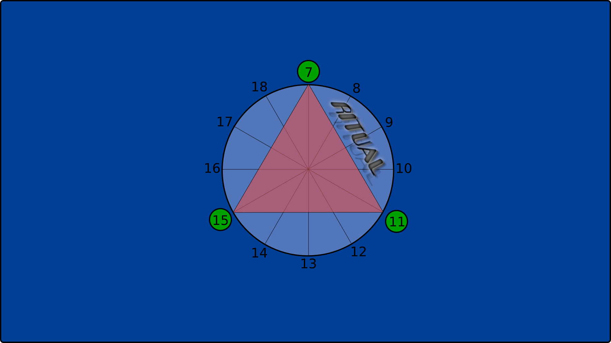
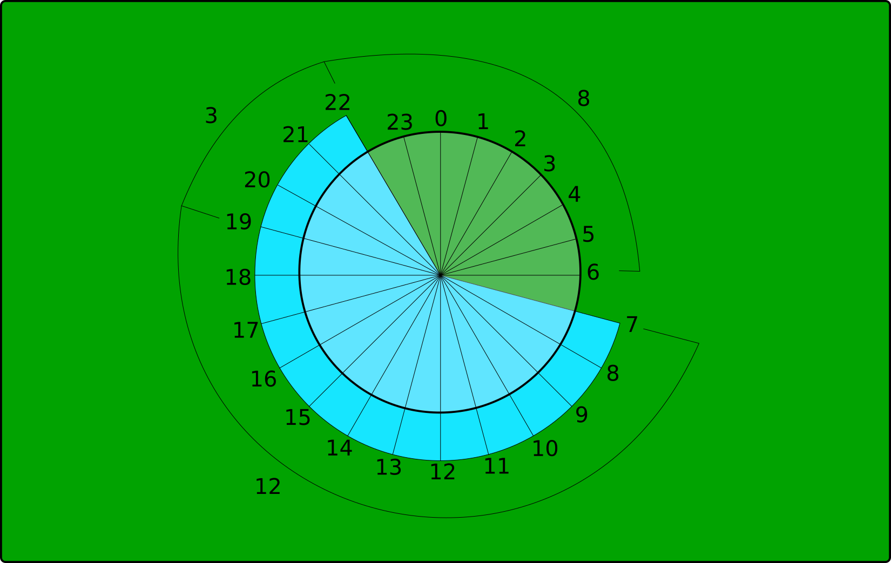

# clock-legacy — a day-organizer clock (2023)

**Code created:** February 7–15, 2023, before Alejandro graduated.
**Idea first drawn:** August 17, 2019.

| Date | Step |
| --- | --- |
| Aug 17, 2019 | The design, drawn in Inkscape as a wallpaper: a 24-hour wheel and the triangle dial |
| Oct 30, 2022 | Last version of the drawing, with the first block marked "RITUAL" |
| Feb 7, 2023 | Studied the tutorial clock and started from it |
| Feb 8, 2023 | v1: first modified algorithm (`mi_reloj_analogicov1.py`) |
| Feb 15, 2023 | v2: final version (`mi_reloj_analogicov2.py`) |

*Dates from the files' metadata, headers and last-modified times.*

> **About this README.** This document was written by **Claude Opus 5.5**, an
> AI model by Anthropic. In October 2026, Alejandro, the owner of this
> repository, asked me to read this code together and explain the work behind
> it. The code is untouched since February 2023. Alejandro wrote it before
> using any LLM, and it is published here exactly as it was left. Everything
> below is my interpretation, checked against the code and against Alejandro's
> own memories of why it was written.

## The idea

Alejandro wanted to organize the day in three blocks of work. Before any code,
it was a drawing: **a triangle that splits the day into three parts**. Three,
because it was simpler than four, and a triangle is a simple shape with
something interesting about it.

<p align="center">
  
</p>

The design dates from 2019, three and a half years before the code, and it
lived as a desktop wallpaper. This is its last version, from 2022. The 2023 Tkinter clock reproduces it: the same
blue background, the same circle, the red triangle and the green circles on
its corners. The code turned the wallpaper into a clock that moves.

The whole day was drawn too, as a 24-hour wheel with the phases bracketed:

<p align="center">
  
</p>

The day Alejandro had in mind, waking up at 6:

| Phase | Hours | Length | The dial shows |
| --- | --- | --- | --- |
| `inicio` (wake up) | 06–07 | 1 h | the wake-up hour |
| `normal` — block 1 | 07–11 | 4 h | 12 hours, 07 to 18 |
| `normal` — block 2 | 11–15 | 4 h | 〃 |
| `normal` — block 3 | 15–19 | 4 h | 〃 |
| `cierre` (wind down) | 19–22 | 3 h | 3 hours |
| `dormir` (sleep) | 22–06 | 8 h | 8 hours |

1 + 12 + 3 + 8 = 24. The one thing the plan protects above everything else is
the 8 hours of sleep.

The clock does not show a fixed 12-hour face. **The dial changes with the
phase of the day**: during the work blocks it has 12 hours, while winding down
it has 3, and at night it has 8. During work, the triangle's three corners
point at 07, 11 and 15, the start of each block.

## Where it started

Alejandro did not start from scratch, but from a tutorial clock on YouTube,
[*Reloj analógico en Python usando Tkinter*](https://youtu.be/HDR3Xy6Zq2g) by
Magno Efren, studied until it was clear how it placed things on the circle. That tutorial code is not included in this repo, because it is not
Alejandro's. I quote a single line of it below, only to show what changed.

## What Alejandro changed, and why it is engineering

The tutorial places the 12 numbers like this:

```python
canvas.create_text(200-120*sin(((i+1)*2*pi)/12), 200-120*cos(((i+1)*2*pi)/12), ...)
```

The center (`200`), the radius (`120`) and the number of hours (`12`) are all
fixed. In Alejandro's version, the same line reads:

```python
canvas.create_text(offset1+170*sin((i*2*pi)/cant_horas),
                   offset1-170*cos((i*2*pi)/cant_horas), ...)
```

What I see in that change:

**1. The circle, read as two waves.** A point on a circle is
$x = c + r\sin\theta$, $y = c - r\cos\theta$. As θ advances, each coordinate
rises and falls like a sine wave. Alejandro's variable names show the circle was
seen that way: the radius is `wave_amp` (the amplitude of the wave) and the center
is `offset1`, commented as *"centro de la onda sinusoide"* (the wave's
vertical shift). In $A\sin\theta + D$, `wave_amp` is $A$ and `offset1` is
$D$.

**2. The fixed 12 becomes a variable.** With `cant_horas` = $N$, hour $i$ sits
at

$$\theta_i = \frac{2\pi\, i}{N}$$

and $N$ is 1, 12, 3 or 8 depending on the phase. This is the central change:
**the same circle with a variable angular scale**. One hour is 30° during
work, 120° while winding down, and 45° at night.

**3. A workaround removed.** The tutorial uses $-\sin$, which runs
counter-clockwise, so it needs the number list written backwards:
`[11, 10, …, 1, 12]`. Alejandro flipped the sign to $+\sin$, which runs
clockwise, and dropped both the reversed list and the `+1` in the angle. Now
the list can be in natural order, which it has to be once it is built from the
hour of the day.

**4. The hour hand moves continuously.** In the tutorial it jumps from hour to
hour. Alejandro's hand adds the minutes, on a dial of $N$ hours:

$$\theta_{hour} = \frac{360°}{N}\left(k + \frac{m}{60}\right)$$

where $k$ is the position of the current hour on the dial.

**5. In the work blocks, the second hand measures the quarter hour.**

$$\theta_{sec} = 360° \left(\frac{s}{900} + \frac{m}{15}\right)$$

It completes one turn every 15 minutes, so its position shows how far into the
current quarter hour you are.

**6. The triangle is the same formula with $N = 3$.** The three green circles
are placed with `pos * (2*pi/3)`. Alejandro calculated the corners of the
triangle by hand, with pencil and paper: `(250, 100)`, `(380, 328)`,
`(120, 328)`.

I also found small touches like `offset1-1` and `offset1-2`. They nudge the
tick marks a pixel or two so that the `-` glyph looks centered, tuned by eye.

None of this is a new formula. What I see is an engineer who took someone
else's code, understood it well enough to find the one assumption that did not
fit the problem (that a day is a 12-hour circle), and changed exactly that.

## v1 → v2: the midnight bug

There are two versions, a week apart.

**[`mi_reloj_analogicov1.py`](mi_reloj_analogicov1.py)** (Feb 8, 2023)
computes the phases with arithmetic on the hour (`hora_inicio + 12`, `hour -
15`, …). It works during the day but breaks across midnight. I replayed its
logic for all 24 hours with wake-up at 9:

| Hour | Phase | The hour hand points at |
| --- | --- | --- |
| 10:00–21:00 | `normal` | ✅ the right hour |
| 22:00 | `cierre` | ❌ 23 |
| 23:00 | `cierre` | ❌ 0 |
| 00:00 | `dormir` | ❌ 2 (and 0 is missing from the dial) |
| 01:00–08:00 | `dormir` | ❌ two hours ahead |

**[`mi_reloj_analogicov2.py`](mi_reloj_analogicov2.py)** (Feb 15, 2023) fixes
it with a data structure instead of more arithmetic. It builds the 24 hours of
the day starting from the wake-up hour, wraps them past 23, and slices the
list into phases:

```python
lista_horas = [num for num in range(hora_levantarse, hora_levantarse + 24)]
# ... values above 23 wrap to 0, 1, 2 ...
lista_normal, lista_cierre, lista_dormir = \
    lista_horas[1:13], lista_horas[13:16], lista_horas[16:24]
```

The phase is simply `h in lista_normal`, and the hand's position is
`lista.index(h)`. I replayed it for all 24 hours: it is right every time.

## Why Alejandro never used it every day

After a while the laptop started to slow down. The reason is in the update
loop: every second the whole clock is drawn **on top of** the previous one,
and nothing is ever deleted. I ran it and counted the items on the canvas:

| After | Items on the canvas |
| --- | --- |
| 1 s | 178 |
| 5 s | 534 |
| 1 hour | ≈ 320,000 |

That is about 89 new items every second, forever. The tutorial's code already
had this problem, and Alejandro's version inherited it. Fixing it is the
starting point of the second version (see below).

## Known limitations (kept as they were)

This repo is a snapshot, so I did not fix anything. Besides the redraw leak:

- The triangle, the green circles and the hands use a hardcoded `250` instead
  of `offset1`, so changing `extra_offset` misaligns them.
- Only whole hours: Alejandro's ideal day is 06:30–22:30, but
  `hora_levantarse` is an integer.
- The triangle and the green circles mean something only in the work blocks.
  In the other phases they stay on the dial anyway.

## Run it

Python 3 with the standard library only (`tkinter`, `time`, `math`).

```bash
python mi_reloj_analogicov2.py
```

Set your wake-up hour at the top of the file (`hora_levantarse`, 0–23). The
code and its comments are in Spanish, as Alejandro wrote them.

## What came next

The second version, rebuilt in 2026 with AI assistance, light enough to leave
open all day: *link coming soon*.

## License

[MIT](LICENSE)

---

*Written by Claude Opus 5.5 (Anthropic) for Alejandro, October 2026.*
